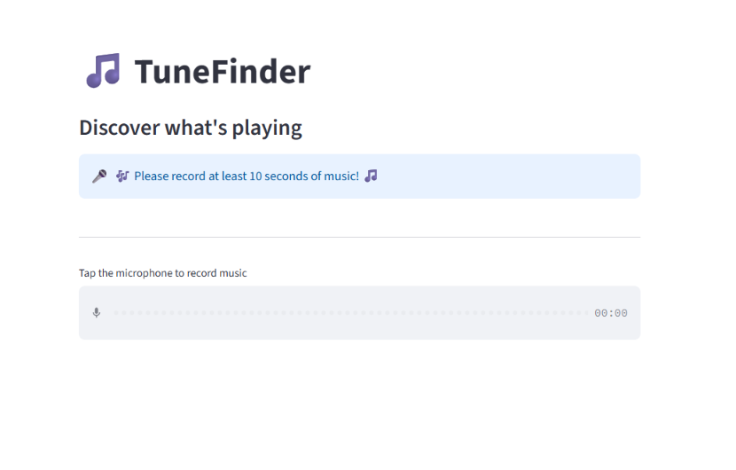
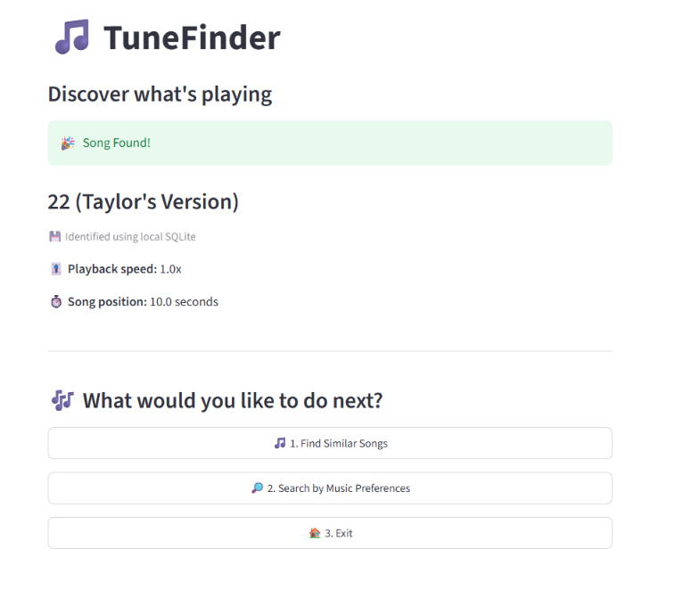
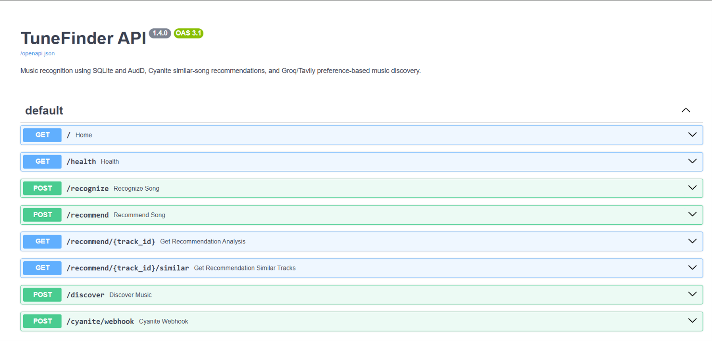

# 🎵 TuneFinder

### 🎧 Intelligent Music Recognition & Recommendation System

**TuneFinder** is a Python-based music recognition and discovery application inspired by Shazam.

It identifies songs from microphone recordings using a local audio fingerprint database, falls back to online recognition, recommends similar music, and supports natural-language music discovery.

Built using **Python, FastAPI, Streamlit, SQLite, AudD, Cyanite, Groq, and Tavily**.

---

## ✨ Key Features

- 🎤 **Song Recognition** — Identify music directly from microphone recordings.
- 🔊 **Audio Fingerprinting** — Generate spectral fingerprints using frequency peaks and timestamps.
- 🗄️ **SQLite Database** — Store and match locally indexed song fingerprints.
- 🌐 **AudD Integration** — Identify songs online when local recognition fails.
- 🎼 **Cyanite Recommendations** — Discover similar songs using audio-based analysis.
- 🤖 **AI Music Discovery** — Search for music using natural-language preferences with Groq and Tavily.
- ✅ **Recommendation Verification** — Separate verified songs from unverified candidates.
- 🖥️ **Streamlit Interface** — Interactive frontend for recording, recognition, and discovery.
- ⚡ **FastAPI Backend** — REST endpoints connecting the frontend and music services.
- 🔄 **Microphone Reset** — Automatically reset recordings shorter than 10 seconds.

---

## 📸 Application Screenshots

### 🏠 1. TuneFinder Home Screen

Record music directly from the Streamlit interface.



### 🎯 2. Song Recognition

Identify music using local audio fingerprinting or AudD online recognition.



### 🛠️ 3. FastAPI Swagger UI

Explore and test the TuneFinder REST API endpoints.



*📌 Screenshots for Cyanite recommendations and AI music discovery will be added in a future update.*

---

## 🛠️ Technology Stack

| Component | Technology |
|---|---|
| 🐍 Programming Language | Python |
| ⚡ Backend | FastAPI |
| 🖥️ Frontend | Streamlit |
| 🗄️ Local Database | SQLite |
| 🔊 Audio Processing | Librosa, NumPy, SciPy |
| 🎯 Music Recognition | Spectral Fingerprinting, AudD |
| 🎼 Similarity Recommendations | Cyanite API |
| 🤖 Music Discovery | Groq, Tavily |
| 🌐 API Communication | REST, JSON |
| 🔧 Version Control | Git, GitHub |

---

## 🏗️ System Architecture

TuneFinder separates music recognition, recommendations, and discovery into independent backend services.

```text
                         👤 USER
                            |
                      🖥️ Streamlit UI
                            |
                   User Selects Action
                            |
          +-----------------+-----------------+
          |                 |                 |
      🎤 Identify     🎼 Similar Songs    🤖 Discover Music
          |                 |                 |
      /recognize        /recommend         /discover
          |                 |                 |
          +-----------------+-----------------+
                            |
                      ⚡ FastAPI Backend
                            |
          +-----------------+-----------------+
          |                 |                 |
     Recognition         Cyanite         Groq + Tavily
       Service           Service           Services
          |                 |                 |
    Fingerprinting     Audio Analysis    Search and
          |                 |            Verification
       SQLite DB       Similar Tracks       Results
          |
      Match Found?
        /      \
       YES      NO
        |        |
    Local Match  AudD API
        |        |
        +--------+
             |
       Recognition Result
```

📖 Read more: [System Architecture](docs/architecture.md)

---

## 🔊 Audio Fingerprinting

TuneFinder uses **spectrogram-based audio fingerprinting** to identify songs through their acoustic characteristics.

### 📥 Audio Ingestion Pipeline

1. 📂 Load audio files from the configured local songs directory.
2. ✂️ Divide songs into overlapping 8-second chunks.
3. 📊 Generate spectrograms.
4. 📈 Detect significant frequency peaks.
5. 🔗 Pair peaks using frequencies and time differences.
6. 🔐 Generate fingerprint hashes.
7. 🗄️ Store fingerprints and timestamps in SQLite.

### ⏱️ Chunking Strategy

| Parameter | Value |
|---|---|
| Chunk Duration | 8 seconds |
| Step Size | 4 seconds |
| Overlap | 4 seconds |

```text
Chunk 1:  0–8 seconds
Chunk 2:  4–12 seconds
Chunk 3:  8–16 seconds
Chunk 4: 12–20 seconds
```

Overlapping chunks improve audio coverage across different positions in a song.

### 🎯 Song Recognition Pipeline

1. 🎤 Capture microphone audio.
2. 🔊 Generate audio fingerprints.
3. 🔍 Search matching hashes in SQLite.
4. ⏱️ Compare fingerprint timestamp offsets.
5. 🏆 Select the strongest consistent alignment.
6. 🌐 Use AudD if local recognition fails.

Fingerprint matching enables TuneFinder to identify matching audio segments even when the recording begins in the middle of a song.

📖 Read more: [Audio Recognition](docs/audio_recognition.md)

---

## 🗄️ Local Music Database

The development database has been tested with **30 locally ingested songs**.

The SQLite database stores fingerprint hashes and their associated timestamps.

Downloaded commercial audio files and the generated database are excluded from the public repository.

Users can build their own local fingerprint database by ingesting audio files.

---

## 🎤 Recording Validation

TuneFinder requires a minimum recording duration of **10 seconds**.

When a recording is shorter than 10 seconds:

- ⚠️ A warning message appears.
- ⏳ The application waits approximately 3 seconds.
- 🏠 The interface returns to the home screen.
- 🔄 The microphone recorder resets automatically.

Valid recordings proceed to song identification.

---

## 🎼 Music Recommendations

### 🎧 Similar Songs — Cyanite AI

TuneFinder integrates the Cyanite API to analyze audio and retrieve similar-song recommendations.

**Features:**

- 🎵 Audio-based music similarity.
- 🎯 Up to five recommendations.
- 🔗 Spotify listening links when available.
- 🌐 Recommendations from Cyanite's available catalog.

### 🤖 Natural-Language Music Discovery

TuneFinder supports AI-assisted music discovery using **Groq + Tavily**.

Users can enter preferences such as:

> 🎶 Telugu romantic songs featuring Nani in 2026

The discovery system:

1. 🔎 Searches for relevant music information using Tavily.
2. 🧠 Analyzes candidate songs using Groq.
3. ✅ Verifies available song information.
4. 📋 Separates verified recommendations from unverified candidates.

This approach helps reduce unsupported music recommendations.

📖 Read more: [Recommendation System](docs/recommendation_system.md)

---

## 🌐 REST API Endpoints

TuneFinder uses FastAPI to connect its frontend and backend services.

| Method | Endpoint | Purpose |
|---|---|---|
| POST | `/recognize` | 🎤 Identify recorded music |
| POST | `/recommend` | 🎼 Submit audio for similarity analysis |
| GET | `/recommend/{track_id}` | 🔍 Check Cyanite analysis |
| GET | `/recommend/{track_id}/similar` | 🎵 Retrieve similar songs |
| POST | `/discover` | 🤖 Discover music using text preferences |

📖 Read more: [API Documentation](docs/api_documentation.md)

---

## 🚀 Installation & Setup

### 📋 Prerequisites

- 🐍 Python
- 🔧 Git
- 🌐 Internet connection for external APIs
- 🎤 Microphone access
- 🔑 API credentials for enabled external services

### 1️⃣ Clone the Repository

```bash
git clone https://github.com/Mahee-fanof-msd/TuneFinder.git
cd TuneFinder
```

### 2️⃣ Create a Virtual Environment

```powershell
python -m venv .venv
```

Activate the environment on Windows:

```powershell
.\.venv\Scripts\Activate.ps1
```

### 3️⃣ Install Dependencies

```powershell
pip install -r requirements.txt
```

### 4️⃣ Configure API Credentials

Create a `.env` file in the project root.

Configure the credentials required by the enabled services:

- 🔑 AudD API
- 🔑 Cyanite API
- 🔑 Groq API
- 🔑 Tavily API

**🔒 Security:** Never commit actual API keys or the `.env` file to GitHub.

### 5️⃣ Ingest Local Songs

Place audio files in the configured songs directory.

Run:

```powershell
python -m scripts.ingest_fingerprints
```

This generates audio fingerprints and stores them in SQLite.

### 6️⃣ Start FastAPI

```powershell
python -m uvicorn app.main:app --reload
```

FastAPI backend:

http://127.0.0.1:8000

📘 Swagger UI:

http://127.0.0.1:8000/docs

### 7️⃣ Start Streamlit

Open a separate terminal with the virtual environment activated.

```powershell
streamlit run streamlit_app.py
```

🎵 Streamlit application:

http://localhost:8501

📖 Read more: [Setup Guide](docs/setup_guide.md)

---

## 🧪 Testing

Follow these steps to test TuneFinder:

1. ▶️ Start the FastAPI backend.
2. 🖥️ Launch the Streamlit frontend.
3. 🎵 Play a song indexed in SQLite.
4. 🎤 Record at least 10 seconds.
5. 🔍 Click **Identify Song**.
6. ✅ Review the recognition result.
7. 🎼 Optionally explore similar songs or AI music discovery.

---

## ⚠️ Known Limitations

- 🗄️ Local recognition only works with indexed songs.
- 🎤 Background noise can affect recognition accuracy.
- 🌐 AudD recognition depends on its catalog coverage.
- 🎼 Cyanite recommendations depend on service availability.
- 🤖 Music discovery depends on external API availability and verification quality.
- ⏳ External APIs may impose quotas and rate limits.

---

## 🔮 Future Improvements

- 📚 Expand the local music catalog.
- 🔊 Improve recognition in noisy environments.
- ⚙️ Automate fingerprint ingestion workflows.
- 🧪 Add automated tests and GitHub Actions CI.
- 🐳 Containerize the application using Docker.
- ☁️ Deploy the frontend and backend.
- 📸 Add screenshots for recommendations and AI music discovery.
- 📊 Add recognition performance benchmarks.

---

## 🔒 Privacy & Copyright

Downloaded commercial music and generated local audio databases are not distributed with this repository.

Users are responsible for obtaining appropriate rights to any audio they process or distribute.

API credentials, local recordings, and other sensitive information should remain private.

---

## 📚 Technical Documentation

Explore TuneFinder's detailed technical documentation:

| Document | Description |
|---|---|
| 🏗️ [System Architecture](docs/architecture.md) | Application components, services, and data flow |
| 🔊 [Audio Recognition](docs/audio_recognition.md) | Fingerprinting, chunking, peak matching, and recognition |
| 🎼 [Recommendation System](docs/recommendation_system.md) | Cyanite recommendations and Groq/Tavily discovery |
| 🌐 [API Documentation](docs/api_documentation.md) | FastAPI endpoints and integration details |
| 🚀 [Setup Guide](docs/setup_guide.md) | Installation, configuration, and running the application |

---

## 📌 Project Status

**🟢 Working Local Prototype**

TuneFinder currently supports:

- 🎤 Local song recognition using audio fingerprinting.
- 🌐 AudD online recognition fallback.
- 🎼 Audio-based similar-song recommendations.
- 🤖 Natural-language music discovery.
- 🖥️ Streamlit frontend and FastAPI backend.

**🎵 TuneFinder — Identify Music. Discover More.**