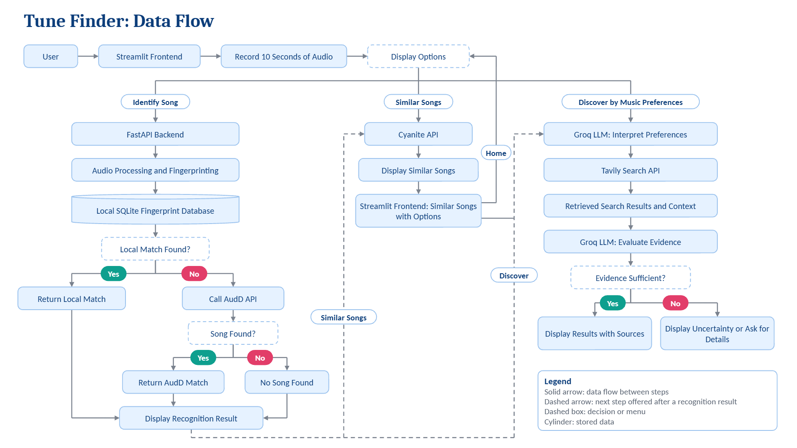

# TuneFinder — System Architecture

## Overview

TuneFinder is a music recognition, recommendation, and discovery application developed using Python, FastAPI, Streamlit, and SQLite.

The application supports three main operations:

1. Song identification using audio fingerprinting and AudD.
2. Similar-song recommendations using Cyanite.
3. Natural-language music discovery using Groq and Tavily.



## High-Level Architecture

```text
                       USER
                         |
                   Streamlit UI
                         |
                User Selects Action
                         |
          +--------------+--------------+
          |              |              |
      Identify       Similar Songs   Discover Music
          |              |              |
      /recognize      /recommend      /discover
          |              |              |
          +--------------+--------------+
                         |
                    FastAPI Backend
                         |
          +--------------+--------------+
          |              |              |
    Recognition       Cyanite       Groq + Tavily
      Service         Service         Services
          |              |              |
    Fingerprinting    Audio Analysis   Search and
          |              |             Verification
      SQLite DB       Similar Tracks    Results
          |
     Match Found?
       /      \
      YES      NO
       |        |
   Local Match  AudD API
       |        |
       +--------+
            |
      Recognition Result
```

## Code Organisation

| Folder | Responsibility |
|---|---|
| `frontend/` | Streamlit user interface |
| `app/main.py` | FastAPI application and endpoints |
| `app/config.py` | Project paths, sample rate, minimum clip length, API settings |
| `app/audio/` | Audio chunking, microphone capture, and processing |
| `app/fingerprinting/` | Fingerprint generation, SQLite storage, and matching |
| `app/services/` | Recognition, AudD, Cyanite, Groq, Tavily, and verification services |
| `scripts/` | Fingerprint ingestion and diagnostic scripts |
| `tests/` | Automated pytest suite |
| `data/` | Local songs, test clips, recordings, and the SQLite database |

## Frontend Layer

The frontend is implemented using Streamlit in `frontend/streamlit_app.py`.

The home screen offers the options shown in the architecture diagram:

- Identify Song
- Similar Songs
- Discover by Music Preferences
- Exit / Home

Responsibilities include:

- Capturing microphone recordings.
- Validating the minimum recording duration of 10 seconds, with a pop-up warning for shorter recordings.
- Sending HTTP requests to FastAPI.
- Displaying identified songs.
- Displaying similar-song recommendations.
- Accepting natural-language music preferences.
- Displaying verified results, possible matches, and their sources.

## Backend Layer

FastAPI manages communication between the frontend and the application's services. It is defined in `app/main.py`.

The backend is responsible for receiving requests, validating inputs, coordinating services, and returning JSON responses.

### Main API Endpoints

| Method | Endpoint | Description |
|---|---|---|
| GET | `/health` | Check that the backend is running |
| POST | `/recognize` | Identify a recorded song |
| POST | `/recommend` | Submit audio for similarity analysis |
| GET | `/recommend/{track_id}` | Retrieve analysis status |
| GET | `/recommend/{track_id}/similar` | Retrieve similar tracks |
| POST | `/discover` | Discover songs using text preferences |
| POST | `/cyanite/webhook` | Receive Cyanite analysis notifications |

## Local Recognition Layer

The local recognition system uses spectrogram-based audio fingerprinting, implemented in `app/fingerprinting/` and coordinated by `app/services/song_recognition_service.py`.

The process involves:

1. Loading audio at 22,050 Hz.
2. Rejecting recordings shorter than 10 seconds.
3. Generating a spectrogram.
4. Detecting significant frequency peaks.
5. Creating peak pairs.
6. Generating fingerprint hashes.
7. Searching matching hashes in SQLite.
8. Comparing timestamp offsets.
9. Selecting the strongest consistent match.

The matcher also checks for altered playback speeds (0.5x, 0.75x, 1.0x, 1.25x and 1.5x), so sped-up or slowed-down recordings can still be recognised.

## External Recognition Layer

When local fingerprint matching does not identify a song, TuneFinder uses the AudD API as an online recognition fallback (`app/services/audd_service.py`).

Recognition success depends on AudD's catalog coverage and recording quality.

## Recommendation Layer

Cyanite is used to analyze audio and retrieve similar-song recommendations (`app/services/cyanite_service.py`).

TuneFinder displays up to five recommendations, including Spotify links when available.

## Music Discovery Layer

The natural-language discovery pipeline uses Groq and Tavily (`groq_service.py`, `tavily_service.py`, and `music_verification_service.py` in `app/services/`).

Its responsibilities include:

- Interpreting user preferences.
- Searching for relevant music information.
- Generating candidate recommendations.
- Verifying song identities and requested attributes.
- Separating verified recommendations from unverified candidates.

## Data Storage

SQLite stores local audio fingerprints and their associated song information in `data/db/fingerprints.db`.

The database is built by running `python -m scripts.ingest_fingerprints`, which fingerprints every MP3 in `data/songs` using overlapping 8-second chunks with a 4-second step.

Commercial audio files and generated local databases are excluded from the public repository.

## Configuration

Shared settings live in `app/config.py`, including project paths, the sample rate, and the minimum clip length.

API keys for AudD, Cyanite, Groq, and Tavily are loaded from a `.env` file in the project root, which is never committed.

## Communication

The Streamlit frontend communicates with FastAPI using HTTP requests.

FastAPI returns structured JSON responses that the frontend uses to update the interface.

## Architecture Benefits

- Modular service design.
- Local recognition without requiring an online lookup for every song.
- Online recognition fallback.
- Separation of recognition, recommendation, and discovery.
- REST API integration.
- Clear folder structure separating the app, frontend, scripts, tests, and data.
- Extensible architecture for future deployment.

## Current Status

TuneFinder is a working local prototype with an automated pytest suite. Its components can be extended with CI, monitoring, Docker, and cloud deployment.